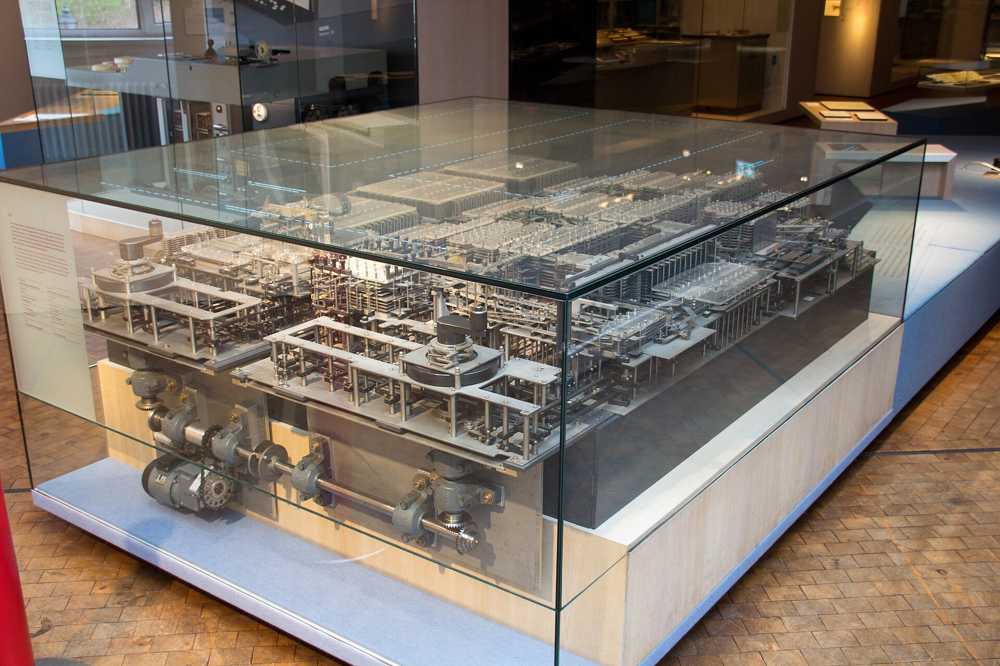
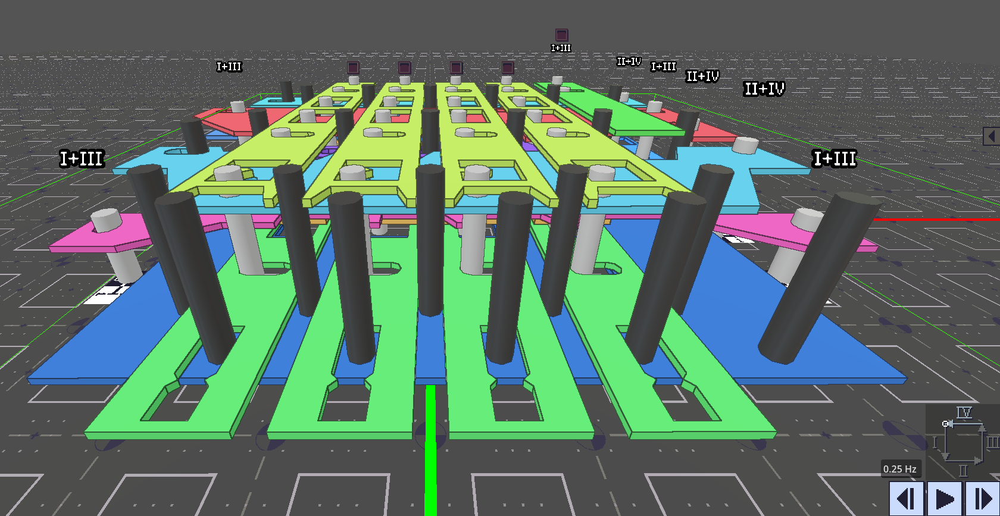
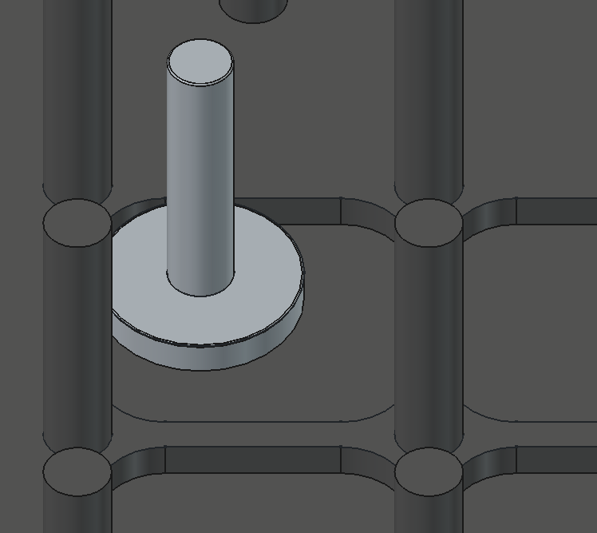
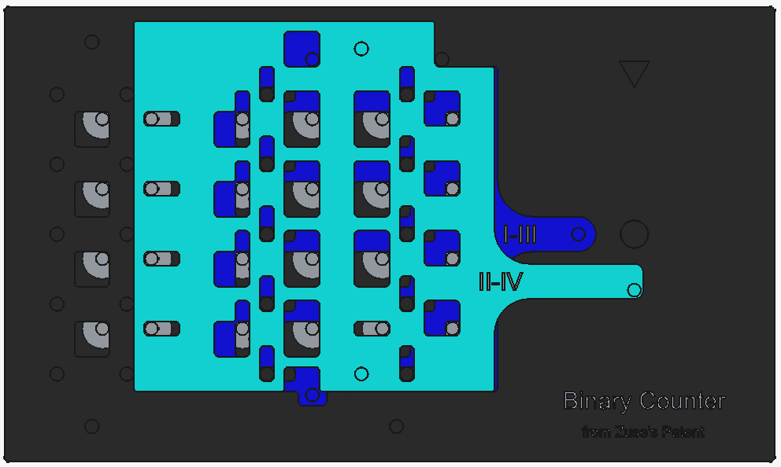
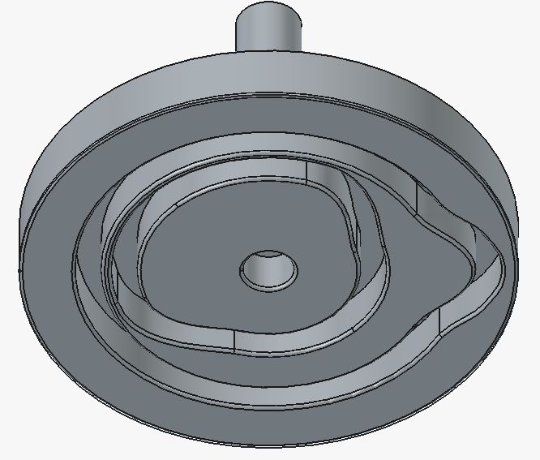

# Zuse Z1 Explorations

  

3D-printable, FreeCAD-designed mechanical models of two small parts of Konrad Zuse's Z1: a **4-bit binary counter** and a **4-bit adder**.

## Contents

- [Short introduction](#short-introduction)
- [4-bit counter](#4-bit-counter)
  - [From simulator to CAD](#from-simulator-to-cad)
  - [Keeping the pins upright](#keeping-the-pins-upright)
  - [Friction and crosstalk](#friction-and-crosstalk)
  - [Clock generation](#clock-generation)
  - [First print](#first-print)
  - [Adding an output register](#adding-an-output-register)
  - [Final design](#final-design)
  - [Simulating the assembly in FreeCAD](#simulating-the-assembly-in-freecad)
- [4-bit adder](#4-bit-adder)

## Short introduction

I have always been fascinated by the [Z1](https://en.wikipedia.org/wiki/Z1_(computer)), the mechanical computer built by [Konrad Zuse](https://en.wikipedia.org/wiki/Konrad_Zuse) and often called the first freely programmable computer. Standing in front of it at the German Museum of Technology in Berlin, it is hard not to be amazed by the ingenuity behind it: thousands of mechanical parts, gears and metal plates work together to perform calculations. An electric motor drives it, but the computing itself is purely mechanical, without a single electronic component.

Its architecture is just as remarkable. The Z1 used a 22-bit binary floating-point format with a 1-bit sign, a 7-bit exponent and a 14-bit mantissa. It could therefore represent a wide range of values with a purely mechanical mechanism, an approach that is still fundamental to modern computing.

Some good starting points:

- Videos: [Konrad Zuse's Z1](https://www.youtube.com/watch?v=HDxs3-aJSAI) and [Zuse Z1 Simulation Demo](https://www.youtube.com/watch?v=Q4zH0n5iPxw&t=1s)
- Paper: [The Z1: Architecture and Algorithms of Konrad Zuse's First Computer](https://arxiv.org/pdf/1406.1886v3)
- Websites: [Z1 Computer](https://en.wikipedia.org/wiki/Z1_(computer)),  [Konrad Zuse](https://en.wikipedia.org/wiki/Konrad_Zuse),  [Architecture and Simulation of the Z1 Computer](https://zuse-z1.zib.de/)

That last website also offers a simulator for small parts of the Z1. Two of its examples, a 4-bit counter and a 4-bit adder, got me thinking about 3D-printed versions.

## 4-bit counter

  

The screenshot shows the simulator with the counter example loaded. It looks simple enough to turn into a design for 3D printing: there are only a few parts to extract, and the simulation shows how they have to move.

<video controls src="docs/assets/counter/counter_sim_2.mp4"></video>

[Video: counter simulation](docs/assets/counter/counter_sim_2.mp4)

The video shows the four phases of each clock cycle and the binary output of the counter. It also shows that two kinds of pins are used: **movable pins** that sit in cut-outs of the sheets and realize the logic functions, and **fixed pins** that only guide the sheets.

### From simulator to CAD

In the simulator the pins stay vertical "magically" and the sheets move horizontally in some other "magical" way. A mechanical design has to make sure that the pins stay vertical and that all clock pins and sheets are driven synchronously.

FreeCAD has improved a lot over the last years, so I wanted to give it a chance for creating the parts and the assembly. I'm not a mechanical engineer, but it should be possible to learn this along the way.

The first part is a base plate for the whole setup. In the simulator it is the fixed blue plate at the bottom, named "m", and it can be modified. The fixed pins can simply be extruded from this plate. I scaled everything so that the pins have a diameter of about 4 mm and the movements are about 6 mm. From there, I recreated all sheets with their cut-outs from the simulator.

### Keeping the pins upright

Movable pins have to be guided and held upright by a mechanical constraint. My solution is a pin with a wide base that moves in a pocket of the base plate. A lid on top prevents it from tilting. (The lid is not shown in the image.) The pins can move in x and y by a defined amount.

  

### Friction and crosstalk

The simulation does not have to deal with friction. In reality the sheets simply lie on top of each other, so the movement of one sheet can be transferred to the sheet above it by friction. This happened in my first build, and I had to add separators between the sheets.

### Clock generation

The next problem was the generation and distribution of the clock. The simulator simply hard-codes the phases and assigns them to the labeled parts. For the mechanical version I use a crank wheel with a groove to create the x and y movements.

  

The phases are generated by two pins that run in the same groove with a 90° offset. The simulator names the x and y clock sheets "I+III" and "II+IV" after the phases in which they act. "I+III", for instance, moves towards -x in phase I and back towards +x in phase III. "II+IV" moves -y in phase II and +y in phase IV, as seen in the video above.

In the simulator each of these sheets is a combination of several sheets. In my design they are single parts named "I+III" and "II+IV", with the color taken from one of the original sheets.

  

The wheel sits on top of the circle on the right and its groove engages the extruded pins of the clock sheets. The sheets themselves are guided by fixed pins, which only allow x or y movements.

A third sheet, called "e", combines the movements of both basic clock sheets. It moves in a square.

  

### First print

The first 3D-printed version implements the original counter from the Z1 patent as shown in the simulator, and the parts are printed in the same colors as in the simulation.

<video controls src="docs/assets/counter/first_version.mp4"></video>

[Video: first printed version](docs/assets/counter/first_version.mp4)

It worked as expected, but the output is only visible during phases I and II. To hold it longer, an output register has to be added.

### Adding an output register

The register needs an additional pulse that captures the output state between phases I and II, which makes it equivalent to an edge-triggered register. Mechanically, I added this pulse as a second groove in the wheel that moves out and back in over a small angle. The wheel diameter had to be increased to make room, and each clock phase was shortened from a quarter to an eighth of a turn to leave room for the pulse between the phases.

  

The movement from the pulse groove turns a lever. The lever moves the register parts, which capture the x position of the yellow sheets and convert it into a y position that moves a flag in or out. The aperture on top shows only the flags that are in the logic-1 position.

### Final design

The video shows the final assembly from bottom to top.

<video controls src="docs/assets/counter/counter_assy.mp4"></video>

[Video: assembly from bottom to top](docs/assets/counter/counter_assy.mp4)

### Simulating the assembly in FreeCAD

FreeCAD's Assembly workbench joints cannot represent pins sliding in cut-outs, so the sheets and pins cannot simply be moved with joints. Claude helped me create a macro that simulates the assembly and demonstrates its function before anything is printed. The macro works out the motion from the real part geometry (every pin against the walls of the sheet cut-outs) and then replays it by setting the placements of the parts in the assembly. The wheel turns at a constant speed and the sheets follow its groove.

To use it: run the macro, press **Recompute**, then press **Start**. To repeat the simulation, press **Start** again.

<video controls src="docs/assets/counter/macro_execution.mp4"></video>

[Video: running the macro](docs/assets/counter/macro_execution.mp4)

And finally, the 3D-printed version in action:

<video controls src="docs/assets/counter/counter_final.mp4"></video>

[Video: the printed counter](docs/assets/counter/counter_final.mp4)

## 4-bit adder

<!-- TODO: this section is a placeholder. The notes below are draft material from the design work. -->

*Work in progress.* The adder follows the same design principles as the counter: sheets with cut-outs, movable pins guided by pockets and lids, and a wheel that drives the clock phases. Notes for this section:

- Pins and sheets are stacked in several levels. I shortened the distance between the levels and the pin lengths to reduce mechanical problems.
- Spacers keep the sheets of neighboring levels apart, and additional spacers on the top level keep parts from falling off.
- The macro also simulates the adder, so any 4-bit sum can be tried out before printing.
