# Zuse Z1 Explorations

  

Picture: Working Z1 replica built by Konrad Zuse in the 1980s as it is showcased in the "German Museum of Technology" in Berlin.   

This repository provides 3D-printable, FreeCAD-designed mechanical models of two small parts of Konrad Zuse's Z1: a **4-bit binary counter** and a **4-bit binary adder**.  

## Contents

- [Short introduction](#short-introduction)
- [4-bit counter](#4-bit-counter)
  - [From simulator to CAD](#from-simulator-to-cad)
  - [Keeping the pins upright](#keeping-the-pins-upright)
  - [Friction and crosstalk](#friction-and-crosstalk)
  - [Clock generation](#clock-generation)
  - [First print](#first-print)
  - [Adding an output register](#adding-an-output-register)
  - [Final design](#final-design)
  - [Simulating the assembly in FreeCAD](#simulating-the-assembly-in-freecad)
- [4-bit adder](#4-bit-adder)
  - [From counter to adder](#from-counter-to-adder)
  - [Keeping long pins upright: rotating arms](#keeping-long-pins-upright-rotating-arms)
  - [Stack-up and basement](#stack-up-and-basement)
  - [Guide rings and lid screws](#guide-rings-and-lid-screws)
  - [The full assembly and its inputs](#the-full-assembly-and-its-inputs)
  - [Anticipating carry](#anticipating-carry)
  - [Following the event chains](#following-the-event-chains)
  - [Simulating the assembly in FreeCAD](#simulating-the-adder-in-freecad)
  - [Design iterations and tolerances](#design-iterations-and-tolerances)

## Short introduction

I have always been fascinated by the [Z1](https://en.wikipedia.org/wiki/Z1_(computer)), the mechanical computer built by [Konrad Zuse](https://en.wikipedia.org/wiki/Konrad_Zuse) and often called the first freely programmable computer. Standing in front of it at the German Museum of Technology in Berlin, it is hard not to be amazed by the ingenuity behind it: thousands of mechanical parts, gears and metal plates work together to perform calculations. An electric motor drives it, but the computing itself is purely mechanical, without a single electronic component.

Its architecture is just as remarkable. The Z1 used a 22-bit binary floating-point format with a 1-bit sign, a 7-bit exponent and a 14-bit mantissa. It could therefore represent a wide range of values with a purely mechanical mechanism, an approach that is still fundamental to modern computing.

Some good starting points:

- Videos: [Konrad Zuse's Z1](https://www.youtube.com/watch?v=HDxs3-aJSAI) and [Zuse Z1 Simulation Demo](https://www.youtube.com/watch?v=Q4zH0n5iPxw&t=1s)
- Paper: [The Z1: Architecture and Algorithms of Konrad Zuse's First Computer](https://arxiv.org/pdf/1406.1886v3)
- Website: [Architecture and Simulation of the Z1 Computer](https://zuse-z1.zib.de/)

That website also offers a simulator for small parts of the Z1. Two of its examples, a 4-bit counter and a 4-bit adder, got me thinking about 3D-printed versions.

## 4-bit counter

  

The screenshot shows the simulator with the counter example loaded. It looks simple enough to turn into a design for 3D printing: there are only a few parts to extract, and the simulation shows how they have to move.

  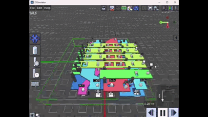

The video shows the four phases of each clock cycle and the binary output of the counter. It also shows that two kinds of pins are used: **movable pins** that sit in cut-outs of the sheets and realize the logic functions, and **fixed pins** that only guide the sheets.

### From simulator to CAD

In the simulator the pins stay vertical "magically" and the sheets move horizontally in some other "magical" way. A mechanical design has to make sure that the pins stay vertical and that all clock pins and sheets are driven synchronously.

FreeCAD has improved a lot over the last years, so I wanted to give it a chance for creating the parts and the assembly. I'm not a mechanical engineer, but it should be possible to learn this along the way.

The first part is a base plate for the whole setup. In the simulator it is the fixed blue plate at the bottom, named "m", and it can be modified. The fixed pins can simply be extruded from this plate. I scaled everything so that the pins have a diameter of about 4 mm and the movements are about 6 mm. From there, I recreated all sheets with their cut-outs from the simulator.

### Keeping the pins upright

Movable pins have to be guided and held upright by a mechanical constraint. My solution is a pin with a wide base that moves in a pocket of the base plate. A lid on top prevents it from tilting. (The lid is not shown in the image.) The pins can move in x and y by a defined amount.

  

### Friction and crosstalk

The simulation does not have to deal with friction. In reality the sheets simply lie on top of each other, so the movement of one sheet can be transferred to the sheet above it by friction. This happened in my first build, and I had to add separators between the sheets.

### Clock generation

The next problem was the generation and distribution of the clock. The simulator simply hard-codes the phases and assigns them to the labeled parts. For the mechanical version I use a crank wheel with a groove to create the x and y movements.

  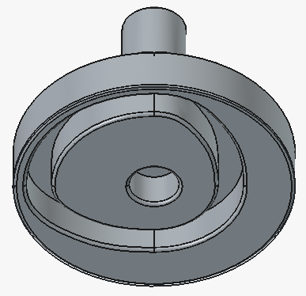

The phases are generated by two pins that run in the same groove with a 90° offset. The simulator names the labels "I+III" and "II+IV" after the phases in which they act. "I+III", for instance, moves towards -x in phase I and back towards +x in phase III. "II+IV" moves -y in phase II and +y in phase IV, as seen in the video above.

In the simulator each of these clock distributions is a combination of several sheets. In the FreeCAD design they are single parts named "I+III" and "II+IV", with the color taken from one of the original sheets.

  

The wheel sits on top of the circle on the right and its groove engages the extruded pins of the clock sheets. The sheets themselves are guided by fixed pins, which only allow x or y movements.

A third sheet, called "e", combines the movements of both basic clock sheets. It moves in a square.

  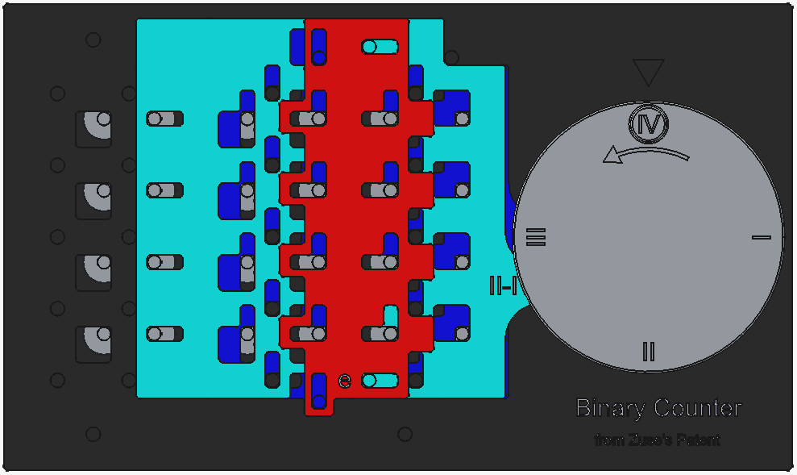

### First print

The first 3D-printed version implemented the original counter from the Z1 patent as shown in the simulator, and the parts are printed in the same colors as in the simulation.

  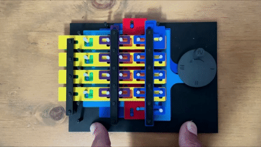

It worked as expected, but the output is only visible during phases I and II. To hold it longer, an output register has to be added.

### Adding an output register

The register needs an additional pulse that captures the output state between phases I and II, which makes it equivalent to an edge-triggered register. Mechanically, I added this pulse as a second groove in the wheel that moves out and back in over a small angle. The wheel diameter had to be increased to make room, and each clock phase was shortened from a quarter to an eighth of a turn to leave room for the pulse between the phases.

  

The movement from the pulse groove turns a lever. The lever moves the register parts, which capture the x position of the yellow sheets and convert it into a y position that moves a flag in or out. The aperture on top shows only the flags that are in the logic-1 position.

### Final design

The video shows the final assembly from bottom to top.

  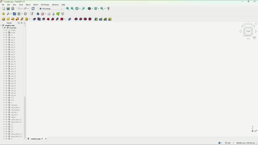

### Simulating the assembly in FreeCAD

FreeCAD's Assembly workbench joints cannot represent pins sliding in cut-outs, so the sheets and pins cannot simply be moved with joints. Claude helped me create a macro that simulates the assembly and demonstrates its function before anything is printed. The macro works out the motion from the real part geometry (every pin against the walls of the sheet cut-outs) and then replays it by setting the placements of the parts in the assembly. The wheel turns at a constant speed and the sheets follow its groove.

To use it: run the macro, press **Recompute**, then press **Start**. To repeat the simulation, press **Start** again.

  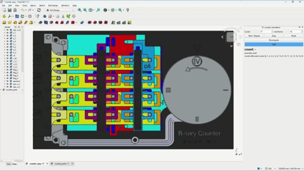

And finally, the 3D-printed version in action:

  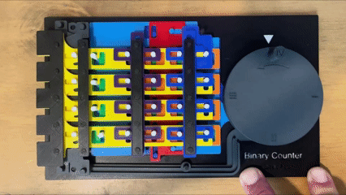

  

## 4-bit adder

### From counter to adder

The adder is much more challenging than the counter. It is organized in four vertical, independent levels, with pins communicating through them. Here are two screenshots of the simulator:

  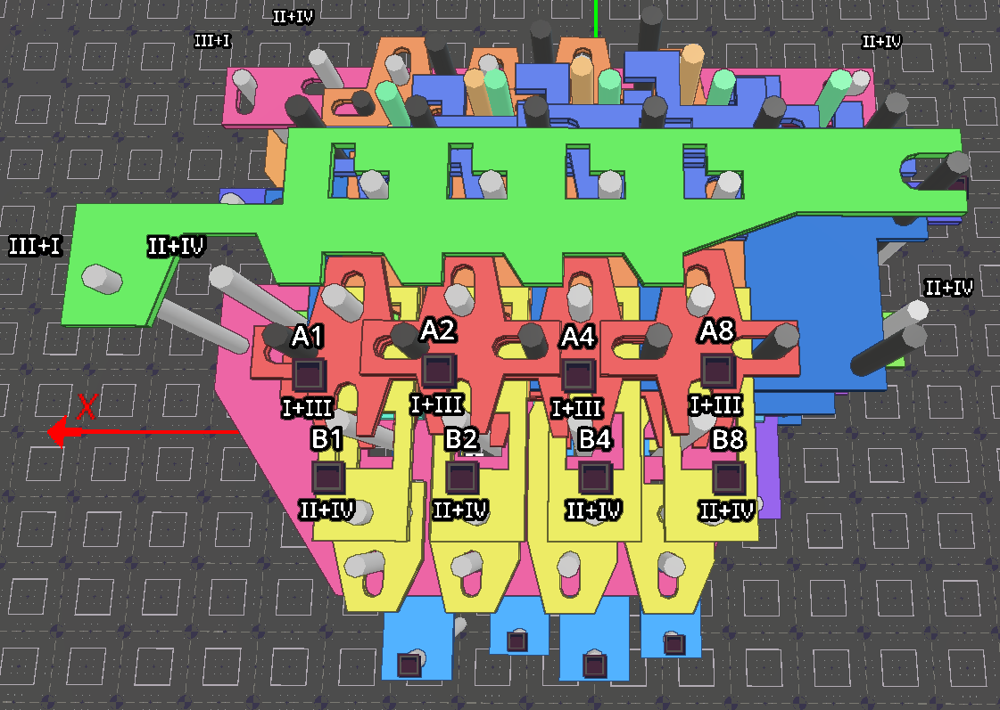

  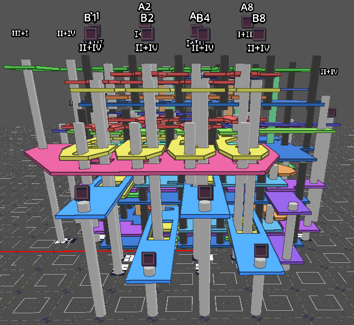

The initial design followed the counter design, but in a 3D-printed version the much longer pins through all levels started to bend and tilt. The long pins therefore had to be replaced with carbon fiber tubes. The fixed pins are simply carbon fiber tubes cut to the correct length for all levels. The moving pins needed a mechanism that holds them upright but still allows a linear movement. Fortunately, these pins only move in either x or y direction and don't need both degrees of freedom.

### Keeping long pins upright: rotating arms

The solution is a rotating arm held in place below the base plate, which approximates the linear motion with a small arc. An arm of 25 mm length causes an error of only about 0.2 mm over a +/-3 mm movement compared to a perfectly linear motion. The carbon fiber tubes are glued into these rotating arms and stick up through all levels.

### Stack-up and basement

This gives the following stack-up:

  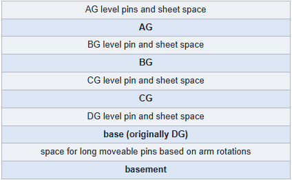

Here is the "basement" arrangement of the rotating arms:

  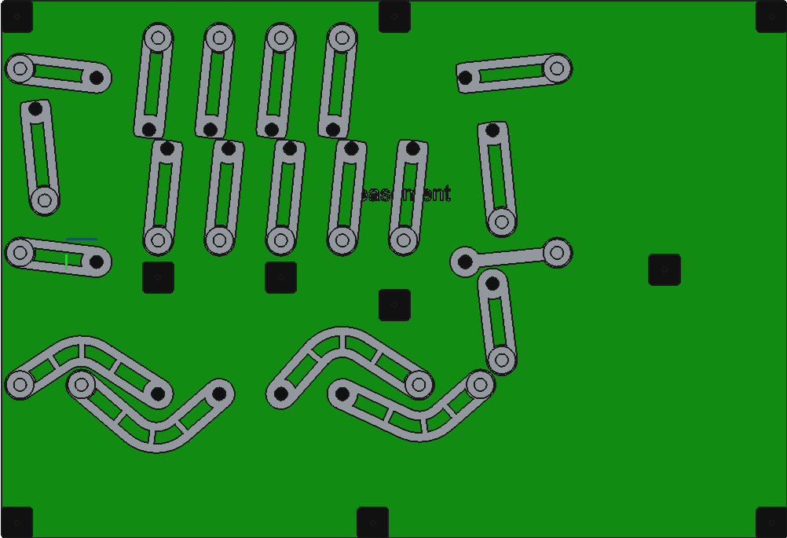

Not all long moving pins could be realized with rotating arms, because there is not enough room for all of them. Only one 4-level pin is left, and it is one of the clock pins. It is the second pin for the same clock phase, and is pushed or pulled at several levels. There are also two 3-level pins, one for carry-in and one for carry-out, which are still not solved well. Finally, there are a few 2-level pins for input and output at the top levels.

### Guide rings and lid screws

The 2-level pins received additional guide rings (`pin_base_loose`) in the AG plate. They look like the pin bases of the counter, run in pockets, and move together with their pin. They are meant to help against tilting.

To keep the lids of the base plates from lifting, which would let the pins bend, screw holes were added around all pin base pockets. Tiny screws hold the lids down. The picture shows the base plate, pins and lid with screw holes:

  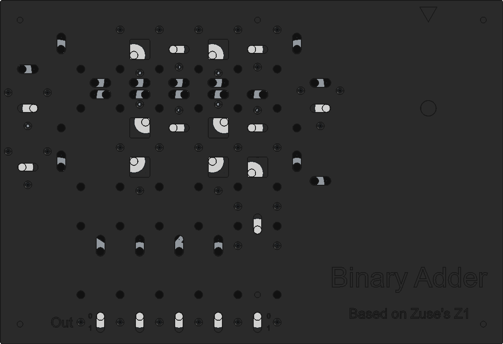

### The full assembly and its inputs

The full assembly looks like this:

  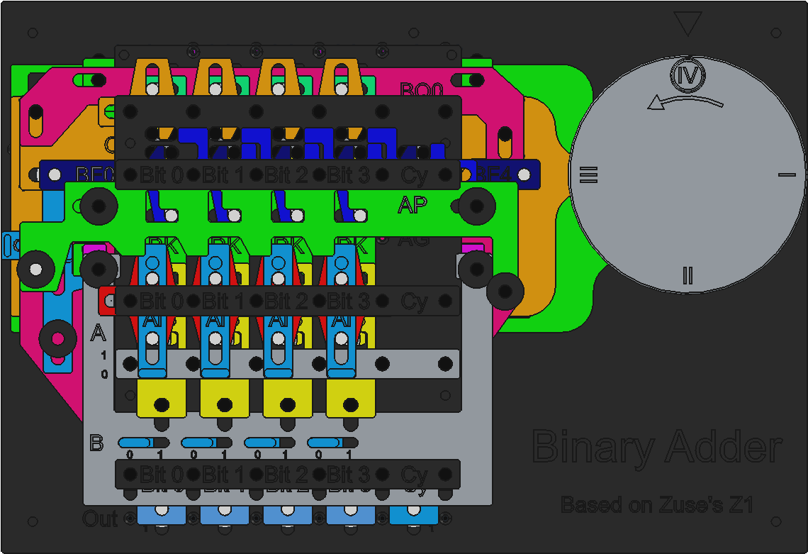

As in the counter, there is a clock wheel on the right side that creates the two clock phases through the sheets "I+III" and "II+IV". The top looks a bit different from the simulator. The simulator only has checkboxes as inputs, but the 3D design needs a physical way to enter the values. The blue parts labeled "Ai" can be shifted towards the "AP" part to set the A-input bits to logic 1. The small sliders below can be shifted to the right to set the B-bits to logic 1. The bit order is printed on the black top parts.

The complexity of the adder shows in the front view:

  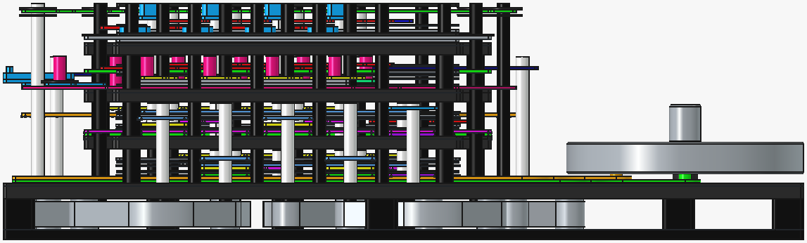

You can clearly see the basement with the arms and all four levels, each with its plates and lids housing the level-specific pins. The levels are densely packed with sheets. The amazing thing about this view is that it shows just a tiny fraction of the whole Z1, a machine Konrad Zuse designed and built in his parents' apartment in Berlin in the 1930s.

### Anticipating carry

Zuse could have built a simple adder that processes one bit per clock, which would need N clocks for N bits and would have been much easier. Instead he made it all work within one clock cycle: phase I inputs A, phase II inputs B, and the result appears in phase IV.

In an electronic adder made of logic gates, each gate has a propagation delay, and the clock period just has to be long enough for the longest path. That path is the carry: each carry from a lower bit can influence the next bit, which can then produce a carry for the one after it, and so on.

The mechanical adder has no such chain of gate delays. All logic has to be evaluated within the available clock phases. The paper [Architecture and Simulation of the Z1 Computer](https://zuse-z1.zib.de/) gives a hint on how this works (page 15):

  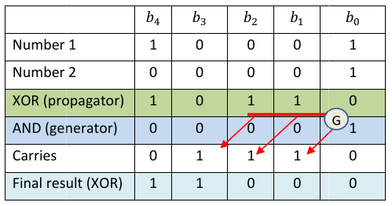

> Konrad Zuse used this so-called "anticipating carriage" in all his machines. Instead of propagating a carry through the different binary powers sequentially, the carry for all positions can be set in one step.  The example above serves to illustrate the procedure. The first XOR is the partial result of the sum of the two registers without considering carriages. The AND computes the generation of carry bits: they are transported to the next bit to the left, but are further transported to the next binary position as long as there is a one in the result of the previous XOR computation. In the example, one carry is generated at the bit 𝑏0 and is propagated to the bits 𝑏3 , 𝑏2, and 𝑏1. All carries are finally XORed with the result of the first XOR. A sequence of consecutive 1's from the first XOR operation operates like a kind of bandwagon for propagating AND-generated carries until the chain of 1's breaks.

### Following the event chains

Looking at the sheets, it is not easy to follow everything that happens in this design. In Chapter 10, "Observations from the 3D Simulation Application", of the [Z1 Adder Description](docs/adder_description.md) I tried to follow and describe the event chains for different inputs as well as I could.

### Simulating the adder in FreeCAD

Claude also helped to create a macro that simulates the adder design in FreeCAD. It can be used to check all movements by hiding or showing parts while the computed cycle is played back. After the inputs are set and the simulation is computed, the wheel turns at a constant speed and all sheets and pins follow. Two examples:

A = 1, B = 1, carry-in = 0 → 1 + 1 + 0 = 2 (00010)

  

A = 5, B = 10, carry-in = 1 → 5 + 10 + 1 = 16 (10000)

  

### Design iterations and tolerances

The adder design went through several iterations. After the initial designs, when switching to carbon fiber tubes, a parameter table was introduced that defines common values for all parts instead of individual fixed values in each part. The table makes it easy to adapt the design to slightly different values. However, FreeCAD likes to move many of the slots in the sketches when the pin diameter is changed, so each sketch has to be checked after such a change.

  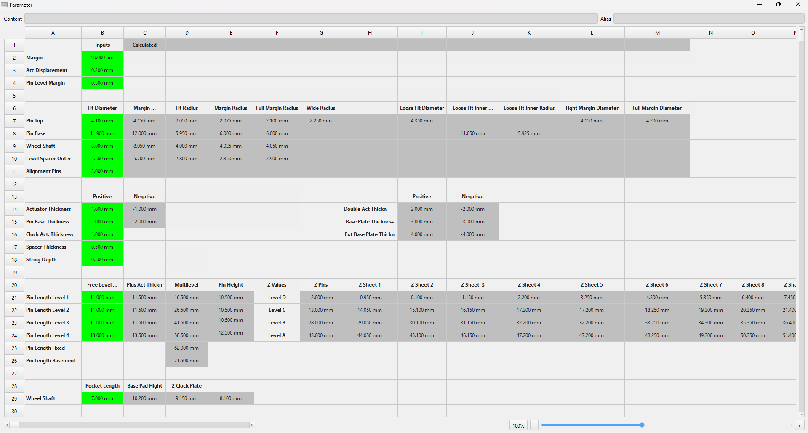

The [carbon fiber tubes](https://www.amazon.com/s?k=Carbon+Fiber+Tubes+4mm+x+2mm+x+430mm+5PC+Pultrusion+Carbon+Fiber+Pipes+for+Quadcopter+Multicoptor+Frame+Body+Landing+Gear+3D+Printer&i=industrial&crid=2HYF6LAOW9MCH&sprefix=carbon+fiber+tubes+4mm+x+2mm+x+430mm+5pc+pultrusion+carbon+fiber+pipes+for+quadcopter+multicoptor+frame+body+landing+gear+3d+printer%2Cindustrial%2C170&ref=nb_sb_noss_1) have an outer diameter of 4 mm, but in test prints a design size of 4.1 mm for pins and holes fits best. This is probably related to the accuracy of the printer.
 
The clearance (margin) was originally set to 0.1 mm. Claude's tolerance calculation over the whole stack-up showed that only about 80% of the intended movement would remain, so the margin was reduced, which brought it up to about 90%. The fit is tight, but so far there has been no downside in the 3D-printed assembly. 

Here is a fast version of the assembly. A full version can be found under assets.

  

  

## TODO

- Print the latest parts and take pictures and videos.
